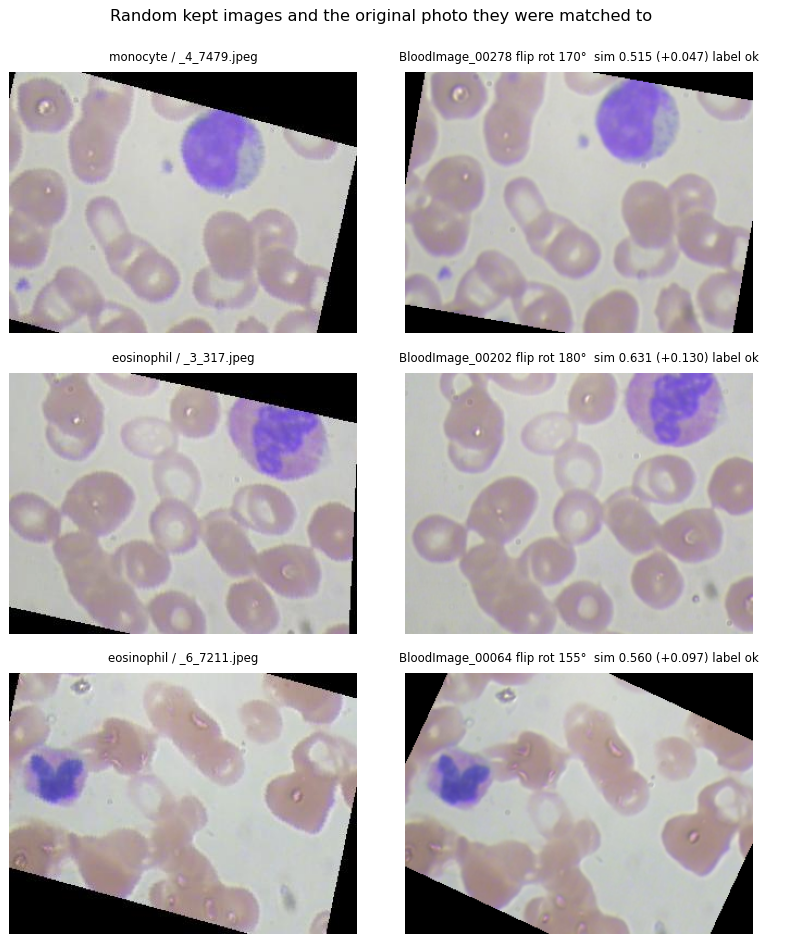
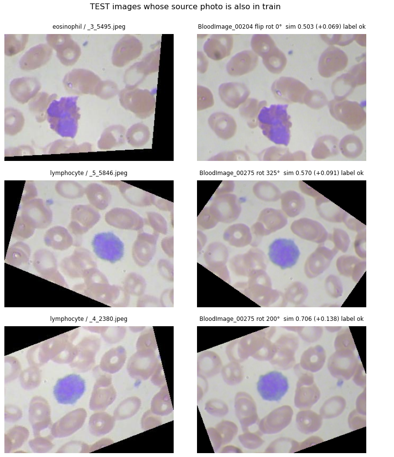
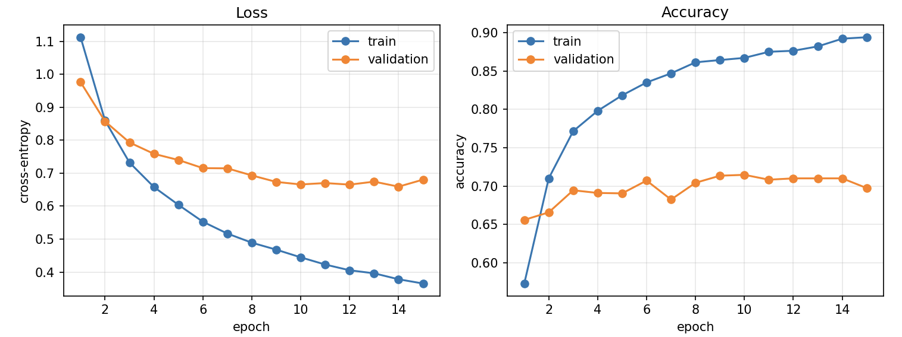
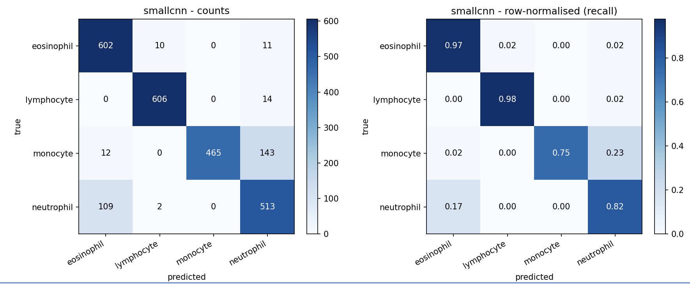
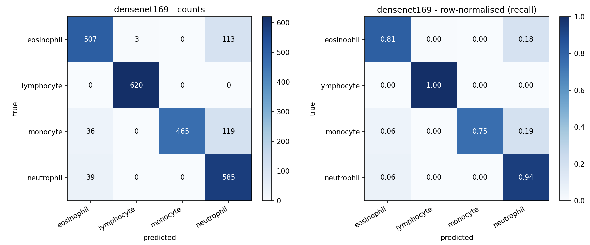
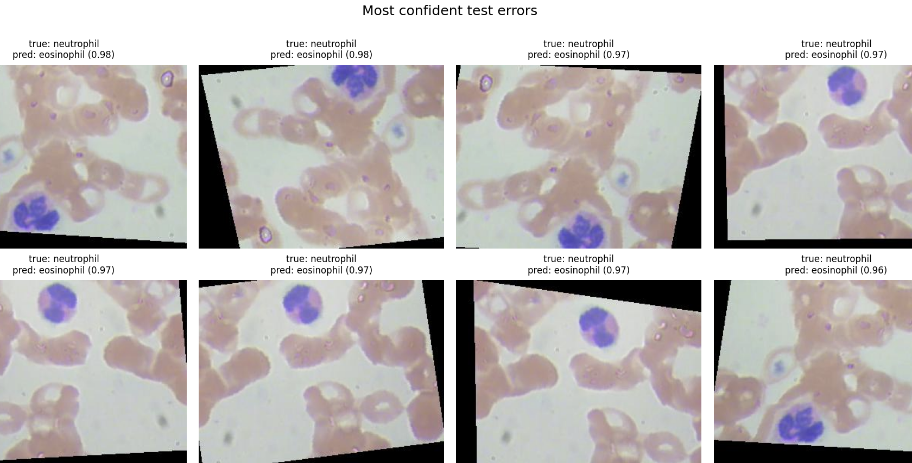
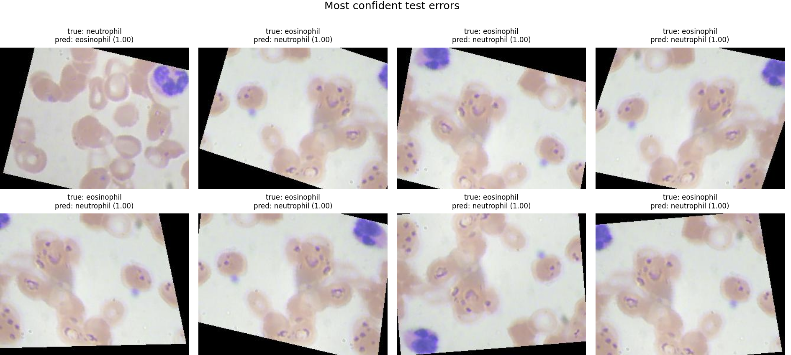
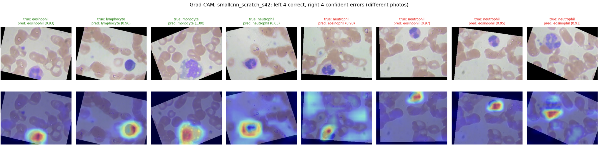
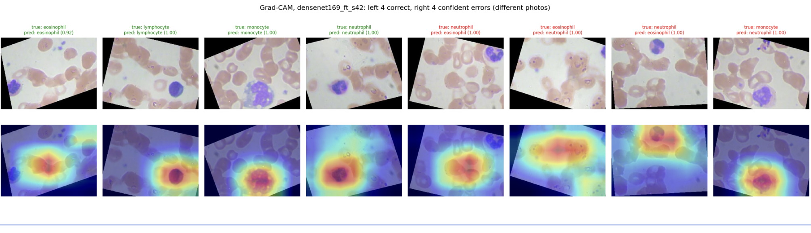

# WBC Classifier: Code and Results Walkthrough

Oct 24, 2026 · Yasmin Rocio Orduz Landazabal

Every step of the final pipeline: the code that runs it and the output it produced. All runs on a Colab T4, 3 seeds per configuration, on the group-aware split. Figures are screenshots of the Colab outputs; the full-resolution PNGs are in Google Drive (`wbc_project/`).

## Headline results

Once the leak is removed, real performance is about 85% macro-F1, not 99–100%, and pretrained models no longer beat a small CNN trained from scratch.

| | Midterm (random split) | Final (group split) |
| --- | --- | --- |
| Validation images whose source photo is also in train | not measured (check reported 25.4% ≥ 0.95 similarity) | **0.0%** (was 99.9% with the random split) |
| Test images whose source photo is also in train | 0.5% (check not rotation-aware) | **6.8%** (170 images, 37 photos) |
| ResNet-50 validation accuracy | 1.000 (1 run) | 0.913 ± 0.012 (3 seeds) |
| SmallCNN validation accuracy | 0.950 (1 run) | 0.917 ± 0.008 (3 seeds) |
| Best test macro-F1 | not evaluated | 0.870 ± 0.011 (DenseNet-169); SmallCNN 0.865 ± 0.015 |
| Clean-test macro-F1 (2,205 images independent of train) | not available | 0.856 ± 0.013 (DenseNet-169); SmallCNN 0.851 ± 0.017 |

The four non-frozen models are within one standard deviation of each other on test. The model selected by validation (rule fixed in advance) is the SmallCNN.

## Step 1 — Data (`src/data.py`)

Kaggle Blood Cell Images (Mooney, 2018): 9,957 TRAIN and 2,487 TEST images, four balanced classes, all 320×240 RGB, 0 corrupt files.

| Class | TRAIN folder | TEST folder |
| --- | --- | --- |
| Eosinophil | 2,497 | 623 |
| Lymphocyte | 2,483 | 620 |
| Monocyte | 2,478 | 620 |
| Neutrophil | 2,499 | 624 |
| **Total** | **9,957** | **2,487** |

The same download holds the 366 original photos (`dataset-master/JPEGImages`, labels in `labels.csv`) from which every image was augmented; Step 2 uses them.

Every image is resized to 224×224 and normalised with ImageNet mean and std. Training images also get light augmentation. Two options were added for the ablations: augmentation off, and how the 4:3 frame becomes square.

```python
def resize_ops(img_size: int, mode: str = "squash") -> list:
    """How the 320x240 (4:3) frame becomes img_size x img_size.

    squash - resize both sides (default, midterm behaviour): keeps the whole frame, stretches it 4:3 -> 1:1
    pad    - add black bars top and bottom to 320x320, then resize: no distortion, nothing lost
    crop   - resize the short side to img_size, centre crop: no distortion, loses ~25% of the width
    """
    if mode == "squash":
        return [transforms.Resize((img_size, img_size), interpolation=bilinear)]
    if mode == "pad":
        return [transforms.Lambda(pad_to_square), transforms.Resize((img_size, img_size), interpolation=bilinear)]
    if mode == "crop":
        return [transforms.Resize(img_size, interpolation=bilinear), transforms.CenterCrop(img_size)]


def build_transforms(img_size=224, train=False, augment=True, resize="squash"):
    sizing = resize_ops(img_size, resize)
    normalise = [transforms.ToTensor(), transforms.Normalize(IMAGENET_MEAN, IMAGENET_STD)]
    if not train or not augment:
        return transforms.Compose([*sizing, *normalise])
    return transforms.Compose([
        *sizing,
        transforms.RandomHorizontalFlip(p=0.5),
        transforms.RandomRotation(degrees=10),
        transforms.ColorJitter(brightness=0.1, contrast=0.1, saturation=0.1, hue=0.02),
        *normalise,
    ])
```

Augmentation is applied to training images only. It cannot leak anything into validation or test; it is justified by what it does (robustness to orientation and stain), and the ablation in the last section measures it. Crop was not chosen as the alternative: several misclassified images have the white cell near the left or right edge, which a centre crop would cut off.

## Step 2 — Finding the leak (`src/group_split.py`)

Every one of the 12,444 Kaggle images is a rotated, flipped or shifted copy of one of 366 original photos, and matching each image back to its photo shows the leak the midterm check missed.

Method: each original photo is rendered in 144 views (2 flips × rotations every 5°, black corners like the augmentation). Every augmented image is described by ImageNet ResNet-50 features cell by cell inside the central circle of the frame, then assigned to the photo whose best view is most similar. The margin over the second-best photo says how sure the match is.

```python
def embed_original_views(paths, model, device, img_size, angles, batch_size, num_workers, use_amp):
    """Returns (n_originals, n_views, D) and the list of (flip, angle) for each view."""
    views = [(flip, ang) for flip in (False, True) for ang in angles]
    ...
    for x in loader:
        per_view = []
        for flip, ang in views:
            v = TF.hflip(x) if flip else x
            if ang:
                v = TF.rotate(v, float(ang), interpolation=TF.InterpolationMode.BILINEAR, fill=[0.0, 0.0, 0.0])
            v = TF.resize(v, [img_size, img_size], antialias=True)
            per_view.append(embed(model, normalise(v), use_amp))
        out.append(torch.stack(per_view, dim=1).cpu())  # (b, V, D)
    return torch.cat(out), views


def match_to_originals(aug, orig_views, device, chunk=256):
    """For every augmented image: best original, its best view, similarity, and margin to the runner-up."""
    n_orig, n_views, dim = orig_views.shape
    ref = orig_views.reshape(n_orig * n_views, dim).to(device)
    for i in range(0, len(aug), chunk):
        s = (aug[i:i + chunk].to(device) @ ref.T).view(-1, n_orig, n_views)
        s_orig, v_idx = s.max(dim=2)                 # best view per original
        top = s_orig.topk(2, dim=1)                  # best and second-best photo
        ...
```

Command (Colab, about 3 min on a T4):

```bash
python src/group_split.py --data-root data --out group_split.json --min-margin 0.02 --val-frac 0.2
```

Printed output (matching quality):

```text
Originals: 366 photos in data/dataset-master/dataset-master/JPEGImages  (labels for 367)
Views per original: 2 flips x 72 rotations
=== Matching quality (resnet50 decides) ===
Label agreement (matched photo's label contains the image's class): 97.4%
  by class: {'EOSINOPHIL': 0.9763, 'LYMPHOCYTE': 0.9726, 'MONOCYTE': 0.9632, 'NEUTROPHIL': 0.9843}
Similarity to matched photo: median 0.586, 1st percentile 0.430
Unsure (margin < 0.02): 783 TRAIN-folder images excluded, 172 TEST images not counted as clean.  Photos used: 353 of 366
```

How trustworthy a match is, by margin. Agreement between the image's class folder and the matched photo's label in `labels.csv` is the check:

| Margin over 2nd-best photo | Images | Label agreement | Used? |
| --- | --- | --- | --- |
| 0.000–0.005 | 331 | 55.3% | excluded as unsure |
| 0.005–0.010 | 208 | 72.1% | excluded as unsure |
| 0.010–0.020 | 416 | 81.2% | excluded as unsure |
| 0.020–0.050 | 1,452 | 97.5% | kept |
| 0.050–1.000 | 10,037 | 100.0% | kept |

Random kept images (left) and the original photo they were matched to, shown in the matched rotation (right):



Test images whose source photo is also in the training folder: the same photo, rotated. The midterm check (not rotation-aware) reported 0.5% overlap.



The pixel-thumbnail cross-check (`--features pixels`) agreed with ResNet on only about 25% of images, while the ResNet matches above are visibly correct, so ResNet alone decides. Figures shown are from the first run (cut-off 0.01); the final split uses 0.02.

## Step 3 — Split by source photo

Train and validation are now split by photo, so no photo appears on both sides: validation images sharing a photo with train fell from 99.9% (random split) to 0.0%.

Two rules make this safe: unsure matches (margin < 0.02) are left out of train and validation, and a test image only counts as clean if its photo is not in train and its match is sure.

```python
def group_train_val(classes, groups, val_frac, seed):
    """StratifiedGroupKFold; keep the fold closest to val_frac with the most similar class mix."""
    n_splits = max(2, round(1 / val_frac))
    sgkf = StratifiedGroupKFold(n_splits=n_splits, shuffle=True, random_state=seed)
    for tr, va in sgkf.split(np.zeros(len(classes)), classes, groups):
        mix = np.bincount(classes[va], minlength=len(overall)) / len(va)
        score = abs(len(va) / len(classes) - val_frac) + np.abs(mix - overall).sum()
        ...

# in main():
df["unsure"] = df.margin < a.min_margin
tr_i, va_i = group_train_val(tr_rows.y.to_numpy()[sure], tr_rows.source.to_numpy()[sure], a.val_frac, a.split_seed)
split[tr_pos] = "excluded"                     # unsure TRAIN-folder images
split[tr_pos[tr_idx]] = "train"
split[tr_pos[va_idx]] = "val"
# a test image is NOT clean if its photo is in train, or its match is unsure
df["source_in_train"] = df.source.isin(train_sources) | df.unsure
assert not (set(df.source[df.split == "val"]) & train_sources), "val shares a photo with train"
```

Resulting split (printed by `group_split.py`):

| Class | Train images | Train photos | Val images | Val photos | Excluded (unsure) | Test images | Test photos | Clean test images |
| --- | --- | --- | --- | --- | --- | --- | --- | --- |
| Eosinophil | 1,843 | 65 | 489 | 16 | 165 | 623 | 35 | 489 |
| Lymphocyte | 1,958 | 29 | 333 | 4 | 192 | 620 | 17 | 580 |
| Monocyte | 1,840 | 21 | 447 | 6 | 191 | 620 | 16 | 588 |
| Neutrophil | 1,795 | 131 | 469 | 34 | 235 | 624 | 64 | 548 |
| **Total** | **7,436** | **246** | **1,738** | **60** | **783** | **2,487** | **132** | **2,205** |

Test folder: 2,487 images from 113 photos; 170 images (6.8%) come from 37 photos that are also in train, and 172 are unsure, which leaves 2,205 clean images.

Validation has only 4 lymphocyte and 6 monocyte photos, so per-class validation numbers are noisy. No split can fix that: it is how the dataset was built.

Train-side photo counts in the total row add the per-class counts; a photo can carry two labels, so a few may be counted twice. Test photos per class add to 132 for the same reason (113 distinct).

## Step 4 — Models (`src/model.py`)

Four networks share one interface: each pretrained model gets a new 4-way linear head, named `fc` or `classifier`, so one function freezes any backbone.

```python
def build_model(name: str = "resnet50", num_classes: int = 4, pretrained: bool = True) -> nn.Module:
    name = name.lower()
    if name == "resnet50":
        weights = ResNet50_Weights.IMAGENET1K_V2 if pretrained else None
        model = resnet50(weights=weights)
        model.fc = nn.Linear(model.fc.in_features, num_classes)
        return model
    if name == "efficientnet_b0":
        weights = EfficientNet_B0_Weights.IMAGENET1K_V1 if pretrained else None
        model = efficientnet_b0(weights=weights)
        model.classifier[1] = nn.Linear(model.classifier[1].in_features, num_classes)
        return model
    if name == "densenet169":
        weights = DenseNet169_Weights.IMAGENET1K_V1 if pretrained else None
        model = densenet169(weights=weights)
        model.classifier = nn.Linear(model.classifier.in_features, num_classes)
        return model
    if name == "smallcnn":
        return SmallCNN(num_classes)
    raise ValueError(f"Unknown model '{name}'. Choose one of {MODEL_NAMES}.")


def set_backbone_trainable(model: nn.Module, trainable: bool) -> None:
    """Freeze/unfreeze everything except the classification head."""
    for pname, p in model.named_parameters():
        is_head = pname.startswith(HEAD_PREFIXES)      # ("fc.", "classifier.")
        p.requires_grad = True if is_head else trainable
```

| Model | Parameters | Head replaced | Trainable when frozen |
| --- | --- | --- | --- |
| SmallCNN (4 conv blocks, from scratch) | 0.4 M | classifier | all |
| EfficientNet-B0 (ImageNet) | 4.0 M | classifier[1], 1280 → 4 | 5,124 |
| DenseNet-169 (ImageNet) | 12.5 M | classifier, 1664 → 4 | 6,660 |
| ResNet-50 (ImageNet) | 23.5 M | fc, 2048 → 4 | 8,196 |

Grad-CAM needed one fix for DenseNet: its last layer is followed by an in-place ReLU that overwrote the stored activations, so the forward hook now stores a copy (`output.detach().clone()`).

## Step 5 — Training recipe and the 15-run grid (`src/train.py`, `src/run_experiments.py`)

One recipe for every model, so the only thing that changes between runs is the backbone.

| Setting | Value |
| --- | --- |
| Optimiser | Adam, weight decay 1e-4 |
| Learning rate | head 1e-3; backbone 1e-4 once unfrozen |
| Schedule | 2 head-only epochs, then full fine-tuning (frozen runs: head only for all 15 epochs) |
| Epochs / batch | max 15 (SmallCNN 20) / 64, mixed precision |
| Early stopping | validation loss, patience 3; checkpoint = lowest validation loss |
| Split | group split file, `--split-seed 42` for every run |
| Seeds | 42, 43, 44 (initialisation, data order, augmentation) |

```python
def build_grid(a):
    """List of (run_name, model, extra train.py flags, seed, epochs, freeze_epochs)."""
    grid = []
    for seed in a.seeds:
        if not a.only_ablations:
            for m in a.finetune_models:      # resnet50, efficientnet_b0, densenet169
                grid.append((f"{m}_ft_s{seed}", m, [], seed, a.epochs, a.freeze_epochs))
            for m in a.frozen_models:        # resnet50
                grid.append((f"{m}_frozen_s{seed}", m, [], seed, a.epochs, a.epochs))
            if not a.no_baseline:
                grid.append((f"smallcnn_scratch_s{seed}", "smallcnn", [], seed, a.baseline_epochs, 0))
        if a.ablations or a.only_ablations:
            grid.append((f"smallcnn_noaug_s{seed}", "smallcnn", ["--no-augment"], seed, a.baseline_epochs, 0))
            grid.append((f"smallcnn_pad_s{seed}", "smallcnn", ["--resize", "pad"], seed, a.baseline_epochs, 0))
    return grid
```

The runner refuses to mix results from different splits in one folder and skips finished runs, so a Colab disconnect costs only the run in progress.

Command and the start of its plan (dry run):

```bash
python src/run_experiments.py --data-root data --out-dir $EXP --split-file $SPLIT --amp --num-workers 2
```

```text
[1/15] resnet50_ft_s42         --model resnet50 --seed 42 --split-seed 42 --epochs 15 --freeze-epochs 2 --batch-size 64 --lr 0.001 ...
[2/15] efficientnet_b0_ft_s42  --model efficientnet_b0 --seed 42 --split-seed 42 --epochs 15 --freeze-epochs 2 ...
[3/15] densenet169_ft_s42      --model densenet169 --seed 42 --split-seed 42 --epochs 15 --freeze-epochs 2 ...
[4/15] resnet50_frozen_s42     --model resnet50 --seed 42 --split-seed 42 --epochs 15 --freeze-epochs 15 ...
[5/15] smallcnn_scratch_s42    --model smallcnn --seed 42 --split-seed 42 --epochs 20 --freeze-epochs 0 ...
...
[15/15] smallcnn_scratch_s44   --model smallcnn --seed 44 --split-seed 42 --epochs 20 --freeze-epochs 0 ...
```

Total time for the 15 runs: about 2.5 hours on one T4.

## Step 6 — Validation comparison

On the leak-free split, the SmallCNN trained from scratch has the lowest validation loss and highest validation accuracy, so it is the selected model under the rule fixed in advance (lowest mean validation loss).

| Configuration (3 seeds) | Params (M) | Val loss | Val accuracy | Best epoch | Minutes / run |
| --- | --- | --- | --- | --- | --- |
| **SmallCNN, from scratch** | 0.4 | **0.225 ± 0.011** | **0.917 ± 0.008** | 11.0 ± 2.6 | 12.2 ± 2.2 |
| EfficientNet-B0, fine-tuned | 4.0 | 0.262 ± 0.030 | 0.900 ± 0.016 | 3.0 ± 0.0 | 5.6 ± 0.1 |
| DenseNet-169, fine-tuned | 12.5 | 0.275 ± 0.025 | 0.907 ± 0.005 | 4.0 ± 1.0 | 7.2 ± 1.1 |
| ResNet-50, fine-tuned | 23.5 | 0.293 ± 0.016 | 0.913 ± 0.012 | 6.0 ± 4.4 | 8.6 ± 4.2 |
| ResNet-50, frozen backbone | 23.5 | 0.654 ± 0.006 | 0.713 ± 0.004 | 13.3 ± 1.2 | 13.3 ± 0.1 |

What the curves show:

- Fine-tuned models peak at epoch 3–6, then validation loss rises while training loss stays near 0: overfitting the leaky split had hidden.
- The frozen ResNet-50 levels off near 70% validation accuracy while training accuracy climbs to 89%: ImageNet features alone do not separate these cell types.
- The top four configurations are within about 1.5 points of each other, inside the seed-to-seed spread.

ResNet-50 with a frozen backbone, seed 42:



## Step 7 — Test evaluation (`src/evaluate.py`)

On the held-out test folder the selected SmallCNN reaches 0.865 ± 0.015 macro-F1, statistically tied with the three fine-tuned networks. Every saved model was evaluated once, and no decision was changed afterwards.

The clean-subset part of `evaluate.py`:

```python
clean = data["clean_test_idx"]          # test images whose source photo is not in train (from the split file)
if clean is not None:
    yc, pc = y_true[clean], y_pred[clean]
    _, _, f1c, supc = precision_recall_fscore_support(yc, pc, labels=range(len(classes)), zero_division=0)
    present = supc > 0
    metrics["clean_subset"].update(accuracy=float(accuracy_score(yc, pc)),
                                   macro_f1=float(np.mean(f1c[present])),
                                   support={c: int(s) for c, s in zip(classes, supc)})
```

Command, run once per checkpoint, then the summary:

```bash
python src/evaluate.py --checkpoint $EXP/<run>/best.pt --num-workers 2
python src/aggregate_runs.py --out-dir $EXP
```

| Configuration (3 seeds) | Val accuracy | Test accuracy | Test macro-F1 | Clean-test accuracy | Clean-test macro-F1 |
| --- | --- | --- | --- | --- | --- |
| DenseNet-169, fine-tuned | 0.907 ± 0.005 | 0.868 ± 0.013 | **0.870 ± 0.011** | 0.858 ± 0.013 | **0.856 ± 0.013** |
| **SmallCNN, from scratch (selected)** | **0.917 ± 0.008** | 0.862 ± 0.018 | 0.865 ± 0.015 | 0.849 ± 0.021 | 0.851 ± 0.017 |
| EfficientNet-B0, fine-tuned | 0.900 ± 0.016 | 0.860 ± 0.010 | 0.861 ± 0.010 | 0.847 ± 0.011 | 0.846 ± 0.011 |
| ResNet-50, fine-tuned | 0.913 ± 0.012 | 0.846 ± 0.010 | 0.847 ± 0.011 | 0.836 ± 0.010 | 0.836 ± 0.011 |
| ResNet-50, frozen backbone | 0.713 ± 0.004 | 0.589 ± 0.007 | 0.583 ± 0.009 | 0.586 ± 0.010 | 0.579 ± 0.010 |

Per seed, SmallCNN test macro-F1 was 0.879, 0.866 and 0.849, and ResNet-50 fine-tuned 0.845, 0.858 and 0.837.

What it means:

- Real performance is about 85–87% macro-F1. The midterm's 100% validation accuracy came from the leak.
- Clean-test scores are about 1 point lower than full-test scores, which fits the 6.8% overlap.
- Validation overestimates test by about 5 points: it has only a few photos per class.
- Literature: Praveen et al. (2021) report 90% subtype accuracy on this dataset with a random split, so that figure may carry the same leak; it is not reached on a leak-free split.

## Step 8 — Error analysis (`src/error_analysis.py`)

Both models find lymphocytes easy and confuse the granulocytes, and their errors come in whole photos: 3 of 16 monocyte test photos are wrong in every copy, in both models.

Per-class recall on test, seed 42:

| Class | SmallCNN | DenseNet-169 | Main confusion |
| --- | --- | --- | --- |
| Lymphocyte | 0.98 | **1.00** | none (small, round, dense nucleus) |
| Eosinophil | **0.97** | 0.81 | DenseNet: 113 → neutrophil |
| Neutrophil | 0.82 | **0.94** | SmallCNN: 109 → eosinophil |
| Monocyte | 0.75 | 0.75 | 143 / 119 → neutrophil |
| Test macro-F1 | 0.879 | 0.877 | |

The two models fail in opposite directions on neutrophil versus eosinophil. Both have lobed nuclei; the cue is granule colour.

SmallCNN, seed 42:



DenseNet-169, seed 42:



Per photo: the test folder holds only about 113 independent photos, so the errors were counted per source photo too.

```python
def per_photo_table(pred: pd.DataFrame, spec: dict) -> pd.DataFrame:
    pred = pred.assign(photo=pred.path.map(lambda p: spec[test_key(p)]["source"]), ok=pred.true == pred.pred)
    return (pred.groupby(["true", "photo"]).agg(copies=("ok", "size"), share_correct=("ok", "mean"))
            .reset_index().rename(columns={"true": "class"}))
```

| Class | Test photos | SmallCNN: all copies right / all wrong | DenseNet-169: all copies right / all wrong |
| --- | --- | --- | --- |
| Eosinophil | 35 | 32 / 0 | 27 / 2 |
| Lymphocyte | 17 | 15 / 1 | 17 / 0 |
| Monocyte | 16 | 13 / 3 | 13 / 3 |
| Neutrophil | 64 | 50 / 9 | 56 / 1 |

One monocyte photo is worth about 6 points of monocyte recall, so per-class numbers are far less certain than the ± suggests. Photo counts per class add to more than 113 because a few photos carry two labels.

The most confident errors are often the same photo, rotated. SmallCNN (neutrophils called eosinophils):



DenseNet-169 (eosinophils called neutrophils, often with the white cell near the edge):



## Step 9 — Grad-CAM (`src/gradcam.py`)

The SmallCNN looks at the white cell even when it is wrong, so its errors are real neutrophil/eosinophil confusions; DenseNet's attention stays in the image centre when the white cell sits near the edge.

```python
class GradCAM:
    def __init__(self, model: nn.Module, target_layer: nn.Module):
        target_layer.register_forward_hook(self._forward_hook)

    def _forward_hook(self, module, inputs, output):
        self.acts = output.detach().clone()      # clone: DenseNet's in-place ReLU follows this layer
        output.register_hook(lambda g: setattr(self, "grads", g.detach()))

    def __call__(self, x, class_idx=None):
        logits = self.model(x)
        logits[0, class_idx].backward()
        weights = self.grads.mean(dim=(2, 3), keepdim=True)            # one weight per channel
        cam = torch.relu((weights * self.acts).sum(dim=1, keepdim=True))
        cam = F.interpolate(cam, size=x.shape[-2:], mode="bilinear", align_corners=False)[0, 0]
        return (cam - cam.min()) / (cam.max() - cam.min() + 1e-8), logits.detach()
```

Each figure shows 4 correct test examples (one per class) and the 4 most confident errors, each from a different photo. Top row: image; bottom row: heatmap.

SmallCNN, seed 42:



DenseNet-169, seed 42 (blurrier by design: its last feature map is a 7×7 grid):



Both models are wrong at 0.91–1.00 confidence, so the scores are badly calibrated on these errors. These are 8 hand-picked examples: illustrations and hypotheses, not proof.

## Ablations: augmentation and aspect ratio

Both ablations support the original setup: turning augmentation off and padding to square each made the SmallCNN worse and much less stable on test, so the final pipeline keeps augmentation on and the squash resize.

Same recipe and split as the baseline, 3 seeds each (42, 43, 44); only the one setting changes.

```bash
python src/run_experiments.py --data-root data --out-dir $EXP --split-file $SPLIT --only-ablations --amp --num-workers 2
```

| Configuration (SmallCNN, 3 seeds) | Val loss | Val accuracy | Test accuracy | Test macro-F1 | Clean-test macro-F1 | Best epoch |
| --- | --- | --- | --- | --- | --- | --- |
| **Baseline: augmentation on, squash** | **0.225 ± 0.011** | 0.917 ± 0.008 | **0.862 ± 0.018** | **0.865 ± 0.015** | **0.851 ± 0.017** | 11.0 ± 2.6 |
| Augmentation off | 0.395 ± 0.116 | 0.859 ± 0.014 | 0.827 ± 0.052 | 0.827 ± 0.053 | 0.812 ± 0.057 | 4.3 ± 1.5 |
| Pad to square (no distortion) | 0.277 ± 0.069 | **0.938 ± 0.014** | 0.796 ± 0.062 | 0.789 ± 0.061 | 0.780 ± 0.060 | 6.0 ± 3.5 |

Pad-to-square test macro-F1 per seed: 0.797, 0.735 and 0.856.

What it means:

- Augmentation off: validation loss nearly doubles, training stops after about 4 epochs because the model overfits, and test macro-F1 drops about 4 points with three times the seed spread. Augmentation acts as a regulariser here. It is applied to training images only, so it cannot leak into validation or test.
- Pad to square: validation accuracy is the highest of any configuration, yet test macro-F1 is about 8 points lower and swings between 0.735 and 0.856 across seeds. A plausible reason: padding shrinks the 4:3 frame into 224×168 pixels plus black bars, so the white cell gets fewer pixels. That is a hypothesis, not tested here.
- The selection rule (lowest mean validation loss) keeps the baseline, and the test set agrees. Validation accuracy alone would have picked the padded model, which is one more sign that this small validation set is a weak guide.

## Midterm commitments, limitations and open questions

Every item the midterm deck (slides 4 and 9) promised for the final is delivered.

| Promised at the midterm | Status | Where |
| --- | --- | --- |
| Rotation-aware overlap check | Done: matching to the 366 original photos, 144 views each | Steps 2–3 |
| Full frozen-backbone run | Done: ResNet-50 frozen, 3 seeds | Steps 6–7 |
| EfficientNet-B0 and DenseNet-169 under the same recipe | Done, 3 seeds each | Steps 4–7 |
| Test set touched once: accuracy, per-class precision/recall, macro-F1, confusion matrix, next to the 90% baseline | Done | Steps 7–8 |
| Augmentation on/off ablation | Done: SmallCNN with augmentation off, 3 seeds (plus pad-to-square for the aspect-ratio feedback) | Ablations |

Limitations:

- Validation holds few photos per class (4 lymphocyte, 6 monocyte), so it is about 5 points more optimistic than test.
- The ± is seed-to-seed spread on one split. The test set's ~113 photos make per-class numbers much less certain.
- 783 TRAIN-folder images whose source photo could not be identified with confidence were left out of training.
- Grad-CAM figures are a few examples: illustrations, not proof.
- One public dataset; a research prototype, not a clinical tool.
